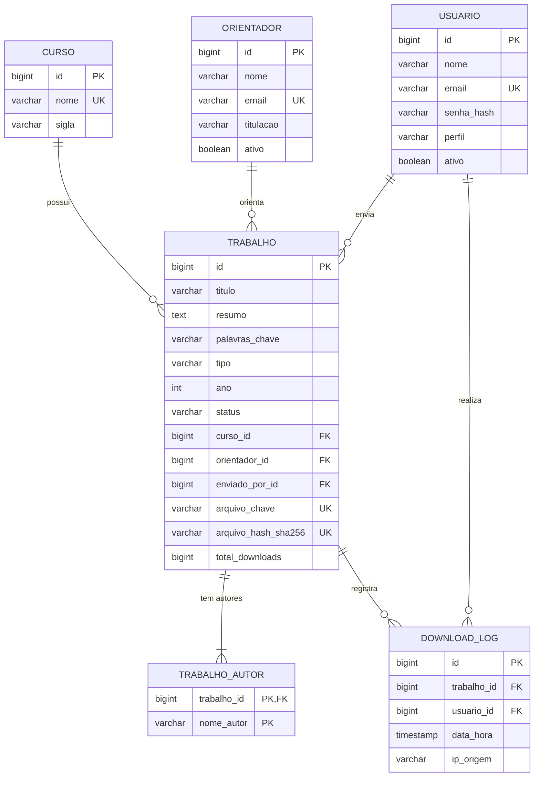

# Repositório de TCCs e Artigos

Spring Boot 3 · Spring Data JPA · MySQL 8 + Flyway · Armazenamento local estruturado em EC2 (AWS Academy).

## Modelo de dados



## Estrutura

```
model/entity     Curso, Orientador, Usuario, Trabalho, ArquivoInfo, DownloadLog
model/enums      TipoTrabalho, StatusTrabalho, Perfil
repository       Spring Data + spec/TrabalhoSpecs (busca dinâmica)
service          CursoService, OrientadorService, TrabalhoService
storage          StorageService → LocalStorageService | S3StorageService
dto              requests/responses
```

## Como funciona

- **Upload**: valida a assinatura `%PDF-`, calcula SHA-256 (bloqueia duplicados), grava no storage em
  `trabalhos/{ano}/{cursoId}/{uuid}.pdf` e salva os metadados. Se o banco der rollback, o arquivo é removido.
- **Moderação**: ALUNO/PROFESSOR enviam como `PENDENTE`; ADMIN/BIBLIOTECARIO publicam direto ou aprovam depois.
  A busca pública só enxerga `PUBLICADO`.
- **Busca**: filtros por curso, ano, orientador e tipo + termo livre (cada palavra deve aparecer em título, resumo,
  palavras-chave ou autor). Para acervos grandes no MySQL, ative o `FULLTEXT INDEX` comentado em `V1__criar_schema.sql`.
- **Armazenamento na EC2**: os PDFs são gravados de forma estruturada no disco da instância EC2 em
  `{STORAGE_LOCAL_DIR}/trabalhos/{ano}/{cursoId}/{uuid}.pdf`.

## Configuração (EC2 + MySQL)

1. Na instância **EC2 (AWS Academy)**:
   - No **Security Group**, libere entrada na porta `22` (SSH) e `8080` (aplicação HTTP).
   - Crie o diretório persistente para os PDFs (fora da pasta do projeto/JAR):
     ```bash
     sudo mkdir -p /var/lib/repositorio-tcc/storage
     sudo chown -R $USER:$USER /var/lib/repositorio-tcc
     ```
2. Suba o **MySQL 8** (via `docker compose up -d` ou instalado diretamente na EC2 / RDS).
3. Copie `.env.example` para `.env`, ajuste `DB_HOST`, `DB_USERNAME`, `DB_PASSWORD` e `STORAGE_LOCAL_DIR`, e rode:
   ```bash
   set -a && source .env && set +a
   mvn clean package -DskipTests
   java -jar target/sistema-repositorio-artigos-1.0.0.jar
   ```
4. Para rodar localmente sem MySQL (H2 em modo MySQL + pasta `storage/`):
   ```bash
   mvn spring-boot:run -Dspring-boot.run.profiles=local
   ```
