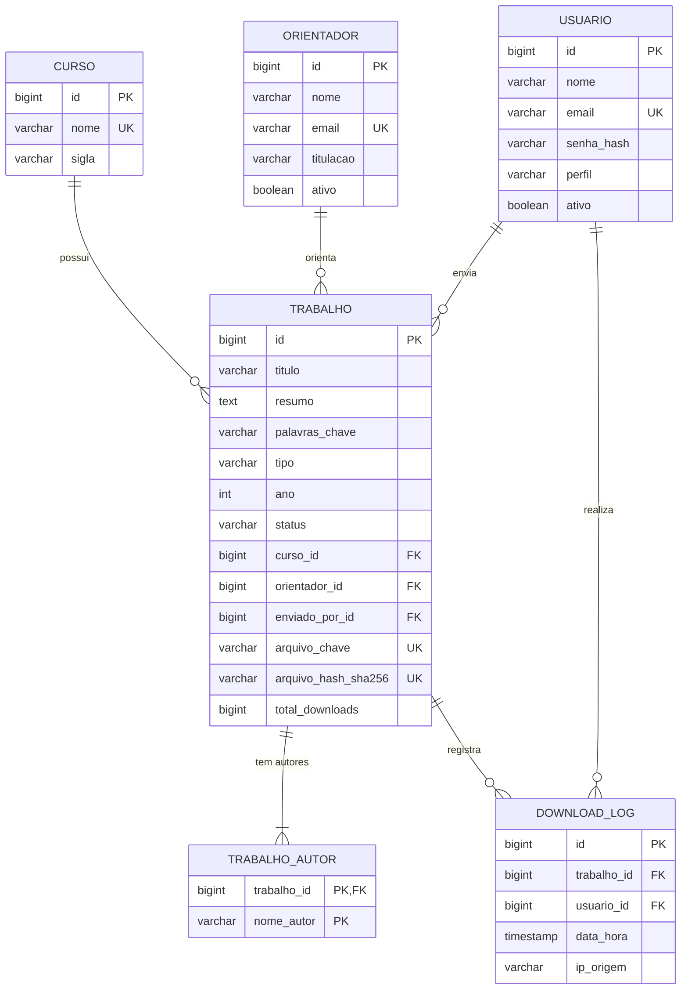

# Repositório de TCCs e Artigos

Spring Boot 3 · Spring Data JPA · PostgreSQL + Flyway · armazenamento local ou AWS S3.

## Modelo de dados



## Estrutura

```
model/entity     Curso, Orientador, Usuario, Trabalho, ArquivoInfo, DownloadLog
model/enums      TipoTrabalho, StatusTrabalho, Perfil
repository       Spring Data + spec/TrabalhoSpecs (busca dinâmica)
service          CursoService, OrientadorService, TrabalhoService
storage          StorageService → LocalStorageService | S3StorageService
dto              requests/responses
```

## Como funciona

- **Upload**: valida a assinatura `%PDF-`, calcula SHA-256 (bloqueia duplicados), grava no storage em
  `trabalhos/{ano}/{cursoId}/{uuid}.pdf` e salva os metadados. Se o banco der rollback, o arquivo é removido.
- **Moderação**: ALUNO/PROFESSOR enviam como `PENDENTE`; ADMIN/BIBLIOTECARIO publicam direto ou aprovam depois.
  A busca pública só enxerga `PUBLICADO`.
- **Busca**: filtros por curso, ano, orientador e tipo + termo livre (cada palavra deve aparecer em título, resumo,
  palavras-chave ou autor). Para acervos grandes, ative o bloco `tsvector`/GIN comentado em `V1__criar_schema.sql`.
- **Troca de storage**: `app.storage.tipo=local` ou `s3` no `application.yml`.
