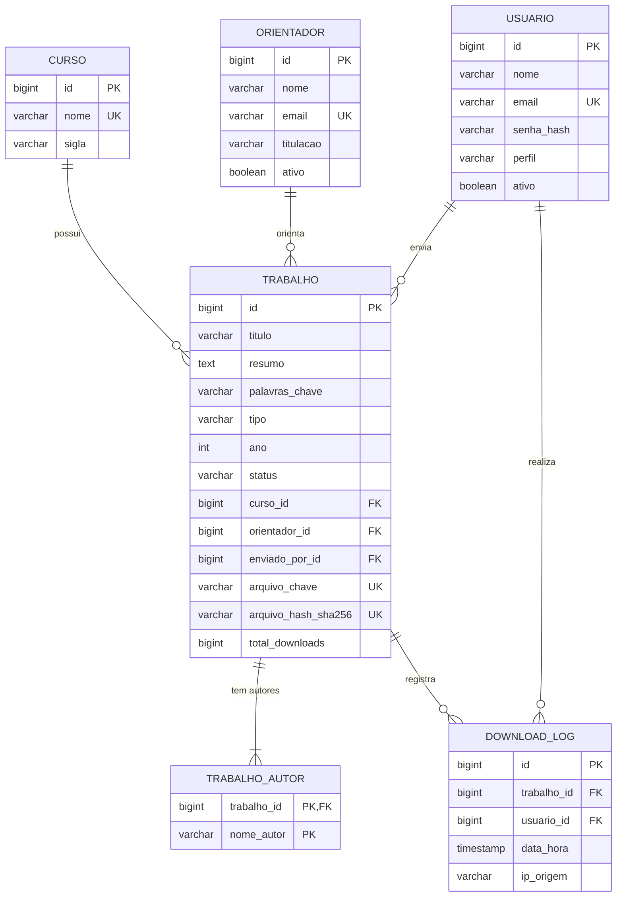

# Repositório de TCCs e Artigos

Spring Boot 3 · Spring Security (JWT) · Spring Data JPA · MySQL 8 + Flyway · Gradle · Angular 19 + Tailwind · Armazenamento local estruturado em EC2 (AWS).

## Modelo de dados



## Estrutura

```
src/main/java/br/com/repositorio
├── backup       BackupService, CatalogoSnapshotService (sincronização SSH + snapshot de metadados)
├── config       SecurityConfig (JWT stateless, CORS e controle de acesso por perfil)
├── controller   Auth, Trabalho, Curso, Orientador, Usuario, Backup, Status, GlobalExceptionHandler
├── dto          requests, responses e PaginaResponse
├── exception    ArmazenamentoException, RecursoNaoEncontradoException, RegraNegocioException
├── model        entity (Curso, Orientador, Usuario, Trabalho, ArquivoInfo, DownloadLog) e enums
├── repository   Spring Data JPA + spec/TrabalhoSpecs (busca textual dinâmica)
├── security     JwtService, JwtAuthenticationFilter, UsuarioDetailsService, AdminSeedRunner
├── service      AuthService, CursoService, OrientadorService, TrabalhoService, UsuarioService
└── storage      StorageService → LocalStorageService (armazenamento estruturado no disco)

frontend/        Aplicação Angular 19 + Tailwind CSS + configuração Nginx (/api -> :8080)
aws-backup/      Scripts bash auxiliares para backup/restauração manual via SSH/rsync
```

## Como funciona

- **Upload**: valida a assinatura `%PDF-`, calcula SHA-256 (bloqueia duplicados), grava no disco estruturado em
  `{STORAGE_LOCAL_DIR}/trabalhos/{ano}/{cursoId}/{uuid}.pdf` e salva os metadados. Se o banco der rollback, o arquivo é removido; se o ano ou curso mudarem na edição, o arquivo é movido de forma sincronizada.
- **Moderação e segurança**: `ALUNO`/`PROFESSOR` enviam como `PENDENTE` e podem editar ou excluir apenas enquanto pendentes; `ADMIN`/`BIBLIOTECARIO` publicam direto, aprovam/arquivam e moderam o acervo. A busca pública enxerga apenas `PUBLICADO` e oculta dados restritos (como e-mails e orientadores inativos).
- **Busca**: filtros por curso, ano, orientador e tipo + termo livre (cada palavra deve aparecer em título, resumo,
  palavras-chave ou autor). Para acervos grandes no MySQL, ative o `FULLTEXT INDEX` comentado em `V1__criar_schema.sql`.
- **Download e visualização**: download com contagem atômica + auditoria (`download_log`), visualização inline no navegador e referência ABNT pronta para cópia.

## Desenvolvimento local

### Backend (Gradle)

Use JDK 25 (LTS) to build and run the backend.

- **Com MySQL via Docker:**
  ```bash
  docker compose up -d
  ./gradlew bootRun
  ```
- **Modo offline sem MySQL (H2 em modo MySQL + pasta `storage/`):**
  ```bash
  ./gradlew bootRun --args='--spring.profiles.active=local'
  ```
- **Testes automatizados:**
  ```bash
  ./gradlew test
  ```
  *(No Windows PowerShell, use `.\gradlew.bat` no lugar de `./gradlew`.)*

### Frontend (Angular 19)

```bash
cd frontend
npm install
npm start
```

Acesse `http://localhost:4200` (o arquivo `frontend/proxy.conf.json` redireciona `/api` para `http://localhost:8080`).

## Deploy na AWS EC2 (1 comando)

1. **Security Group da EC2**: libere entrada nas portas `22` (SSH) e `80` (HTTP via Nginx). A porta `8080` pode permanecer fechada externamente, pois o Nginx encaminha `/api/` para `127.0.0.1:8080`.
2. **Configure o IP e a chave `.pem`**:
   - Copie [ec2/deploy.env.example](ec2/deploy.env.example) para `ec2/deploy.env` e preencha `EC2_HOST` (e `EC2_USER`: `ubuntu`, `admin` ou `ec2-user`).
   - Jogue sua chave `.pem` dentro da pasta `ec2/chaves/` (já ignorada pelo `.gitignore`).
3. **Suba tudo na EC2** (o script compila backend + frontend, instala Java 17, Docker/MySQL 8, Nginx, cria `/var/lib/repositorio-tcc/storage`, configura `systemd` e testa `/status`):
   - **Windows:** `.\ec2\subir-ec2.bat`
   - **Linux / Mac:** `./ec2/deploy-ec2.sh`

## Envio em lote de livros / PDFs para a EC2

1. Coloque os arquivos `.pdf` dentro da pasta `livros/` *(opcionalmente personalize os metadados em [livros/catalogo.csv](livros/catalogo.csv))*.
2. Execute:
   - **Windows:** `.\ec2\enviar-livros.bat`
   - **Linux / Mac:** `./ec2/enviar-livros.sh`

O script faz login como administrador, cria automaticamente cursos/orientadores ausentes, publica cada PDF no acervo da EC2 e ignora arquivos já enviados anteriormente (mesmo SHA-256).
